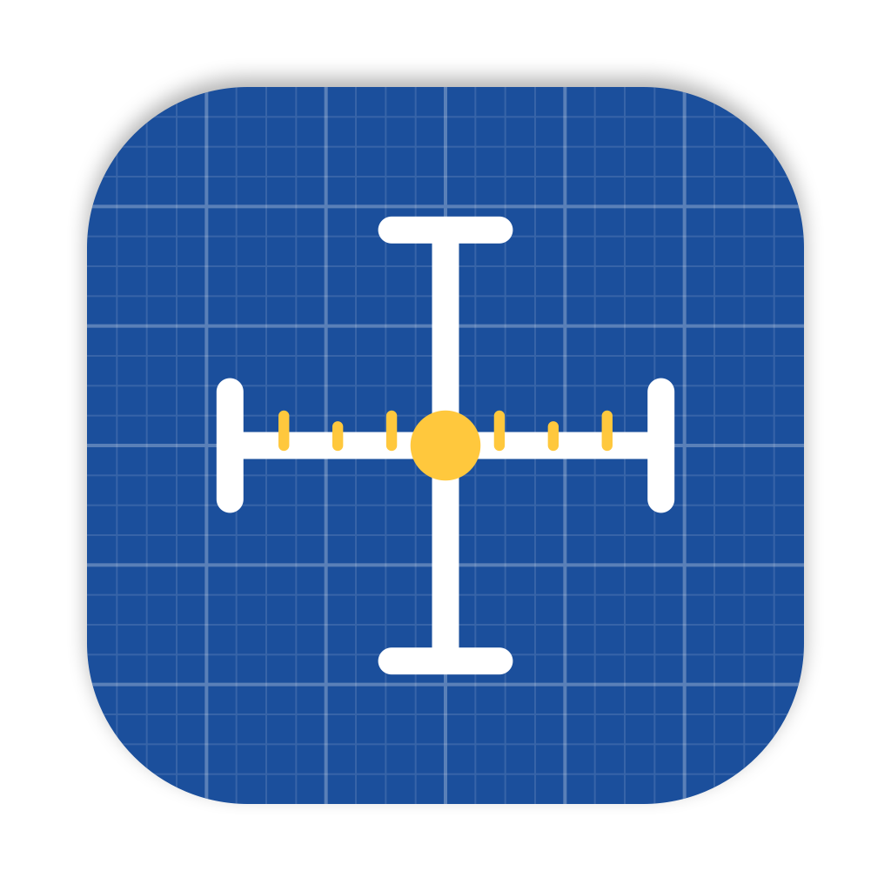

<p align="center"></p>

<h1 align="center">Blueprint+ for Mac</h1>

<p align="center"><strong>Cabinet takeoffs from a PDF plan.</strong><br />
Set the scale, click along each run, and get linear footage by room.</p>

The native macOS version of [Blueprint+](https://github.com/lukeadair/blueprint-plus), with the same features and job
files as the Android app, built for the mouse, trackpad and keyboard.

## Features

- **Precise points.** A magnifier with crosshairs follows the pointer while you measure; arrow keys nudge by a pixel.
- **Multi-point runs.** Click around corners; Return or double-click finishes. Drag a run's points to adjust it later.
- **Scale from the plan**, or **calibrate** from a known dimension (snaps to standard architectural scales).
- **Rooms found automatically** from the plan's text, or on-device OCR for scans; borders found from the walls.
- **Room editing**: drag corners and walls, add, rename, merge, delete, Redetect.
- **Totals by room** in the inspector; drag runs between rooms.
- **Undo and Redo**, **quote spreadsheet** export (.xlsx), and everything saved as you go. No account, no network.

## Install

Requires macOS 26 (Tahoe) or later, on Apple silicon or Intel.

**Homebrew**

```sh
brew tap lukeadair/tap
brew trust lukeadair/tap
brew install --cask blueprint-plus
```

Update with `brew upgrade --cask blueprint-plus`. Your jobs are kept across updates and uninstalls
(`brew uninstall --zap blueprint-plus` deletes them too).

**Download**

Get `Blueprint+-<version>.dmg` from [Releases](https://github.com/lukeadair/blueprint-plus-macos/releases), open it
and drag Blueprint+ to Applications. The app isn't notarized by Apple, so the first launch is blocked: open it once,
then go to **System Settings → Privacy & Security** and click **Open Anyway**. Or, in Terminal:

```sh
xattr -dr com.apple.quarantine /Applications/Blueprint+.app
```

## Build from source

Xcode 26 or later.

```sh
xcodebuild -project BlueprintPlus.xcodeproj -scheme BlueprintPlus -destination 'platform=macOS' test
xcodebuild -project BlueprintPlus.xcodeproj -scheme BlueprintPlus -configuration Release build
```

## Releasing

Bump `MARKETING_VERSION` in the project, commit, then run `scripts/release.sh` (needs `gh` and a checkout of
[lukeadair/homebrew-tap](https://github.com/lukeadair/homebrew-tap) next to this repo). It runs the tests, builds a
universal DMG, publishes the GitHub release and updates the cask. `DRY_RUN=1` stops after the DMG.

## License

MIT
